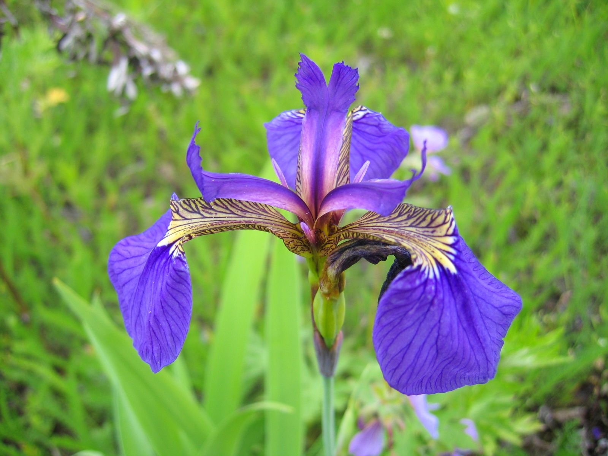
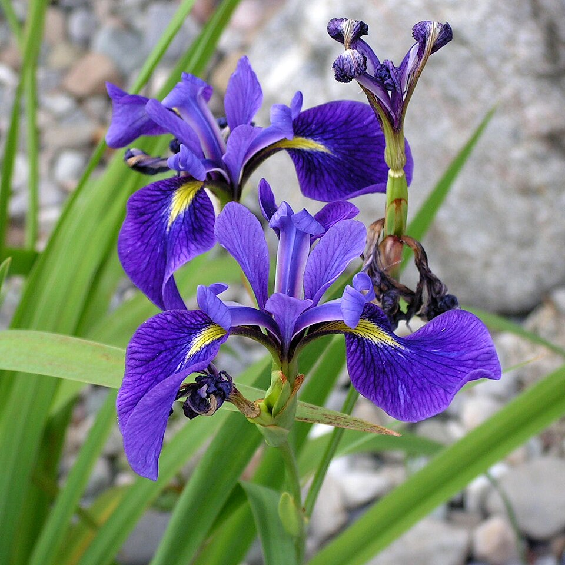
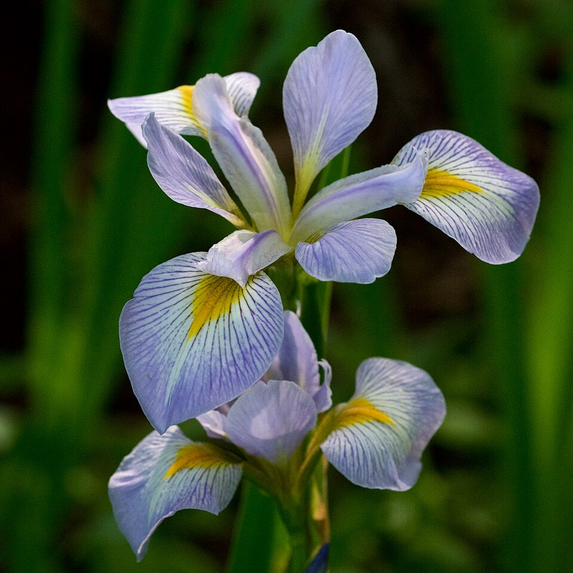

# Iris Dataset — Exploratory Data Analysis

<small>Python · pandas · Matplotlib · Seaborn · Jupyter Notebook</small>

## Summary

An exploratory analysis of the Iris dataset, using charts and descriptive statistics to compare flower measurements across three species. The goal is to understand which measurements show the clearest visual differences, and where the groups still overlap.

**Research question:** How clearly do four basic measurements distinguish *Iris-setosa*, *Iris-versicolor*, and *Iris-virginica* when explored visually?

## The dataset

The dataset contains **150 records**: 50 for each species. Each record has four measurements in centimetres: sepal length, sepal width, petal length, and petal width.

-   

    **Iris setosa**

-   

    **Iris versicolor**

-   

    **Iris virginica**

## Approach

- Checked the dataset structure, missing values, duplicate records, and class balance.
- Compared distributions and descriptive statistics for the four original measurements.
- Used histograms and boxplots to compare measurements across species.
- Explored a few derived measurements as alternative views of the existing dimensions.
- Used correlation heatmaps and pairwise plots to examine relationships between measurements.

## Main findings

- **No missing values** were found. Three rows are exact duplicates; they were retained because matching measurements alone do not establish that a record is erroneous.
- **Petal length and petal width** show the clearest visual separation between species, particularly for *Iris-setosa*.
- *Iris-versicolor* and *Iris-virginica* overlap in several measurement ranges, so the charts do not support a claim that every flower can be distinguished using a single measurement.
- Across all three species, petal length and petal width have a strong positive correlation (approximately **0.96**). Correlation describes an association; it does not demonstrate predictive accuracy or causation.
- Derived products and ratios offer alternative ways to view existing measurements. For example, petal length multiplied by petal width is **not a direct measurement of petal surface area**.

## Limitations

This project is exploratory data analysis, not a trained classifier. No model accuracy or predictive performance is claimed. The observations are based on this dataset and should not be treated as proof that the same patterns hold for every Iris flower.

## View the results and source

- [Open the HTML report](files/Iris_EDA_report.html)
- [Download the PDF report](files/Iris_EDA_report.pdf)
- [Download the notebook, dataset, images, and requirements](files/Iris_EDA_source.zip)

The source archive includes instructions for running the notebook locally.
