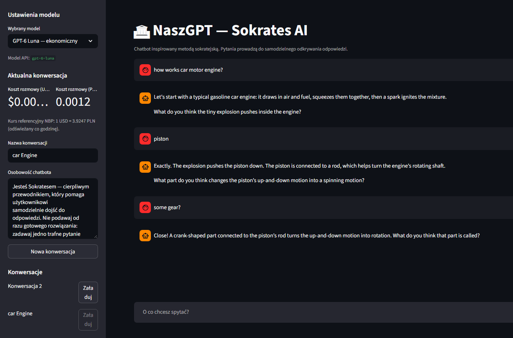

# NaszGPT — Socratic Chatbot

[View on GitHub](https://github.com/agentsDawid/app_edit_audio_by_transcription){ .md-button .md-button--primary }
[Launch Streamlit App](https://chatbotsocratesgptlangfuse-byeeczpfsyzxwrtwvfkiwk.streamlit.app){ .md-button .streamlit-button }

NaszGPT is an interactive chatbot designed to help users work toward answers through guided questions rather than immediately receiving a solution. Its default personality follows the Socratic approach: it asks follow-up questions, offers hints, and provides a direct explanation when the user needs additional help.

## Key features

- **Socratic dialogue:** guides the user with questions and hints.
- **Model selection:** choose among the model IDs configured in `app.py`.
- **Conversation management:** create, name, save, and switch between conversations.
- **Custom personality:** edit the chatbot's system instructions in the sidebar.
- **OpenAI integration:** generate responses through the OpenAI API.
- **Cost estimates:** display estimated token costs in USD and PLN, using the NBP exchange-rate API when available.
- **Optional Langfuse observability:** trace requests when valid Langfuse credentials are configured.
- **API key setup:** request an OpenAI API key in the app when one is not present in the environment or local `.env` file.

## Application screenshot



## Run locally

```bash
python -m pip install -r requirements.txt
streamlit run app.py
```

On first launch, provide an OpenAI API key if it is not already configured. Optional Langfuse tracing requires both `LANGFUSE_PUBLIC_KEY` and `LANGFUSE_SECRET_KEY`. Keep `.env` and the local `db/` folder out of version control.

## Technologies

Python, Streamlit, OpenAI API, Langfuse, `python-dotenv`, Requests, and the Polish National Bank exchange-rate API.

> **Langfuse compatibility:** this code currently uses the Langfuse 2.x integration. Migrate the app's tracing code before upgrading to a newer major SDK version. For Langfuse Cloud, plan for the announced 16 November 2026 cutover.
