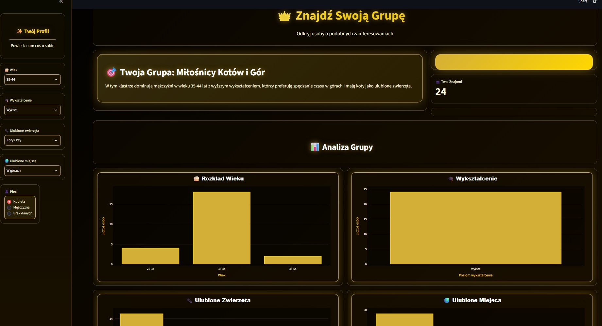

# Find Your Tribe — ML Group Matcher

**Discover your group through machine learning.**

[View on GitHub](https://github.com/YOUR_USERNAME/find-your-tribe){ .md-button .md-button--primary }
[Launch Streamlit App](https://YOUR-APP.streamlit.app){ .md-button .streamlit-button }

## Overview

Find Your Tribe is an interactive Streamlit application that uses a trained clustering model to assign a survey profile to a group with similar characteristics. It displays the group's name, description and number of matching survey participants, then visualizes the group's distribution across selected profile attributes.

## Features

- **Personalized profile:** select age range, education, preferred animals, favorite place and gender.
- **ML-powered grouping:** use a saved PyCaret clustering pipeline to predict a cluster for the selected profile.
- **Group insights:** view the assigned group's name, description and participant count.
- **Interactive charts:** explore distributions of age, education, animal preferences, favorite places and gender with Plotly.

## Technology

## How it works

1. The user selects profile attributes in the sidebar.
2. The application passes the profile to a pre-trained PyCaret clustering model.
3. The predicted cluster is mapped to its saved name and description.
4. The app displays the cluster's participant count and five distribution charts.

The application identifies statistical similarities in survey responses; it does not connect users or establish real-world friendships.

## Project files

The app expects a saved clustering pipeline (`welcome_survey_clustering_pipeline_v2`), survey data (`welcome_survey_simple_v2.csv`) and cluster descriptions (`welcome_survey_cluster_names_and_descriptions_v2.json`). These resources must be available when the app runs.

## Links

- [GitHub repository](https://github.com/agentsDawid/find-your-tribe.git)
- [Streamlit demo](https://find-your-tribe.streamlit.app)