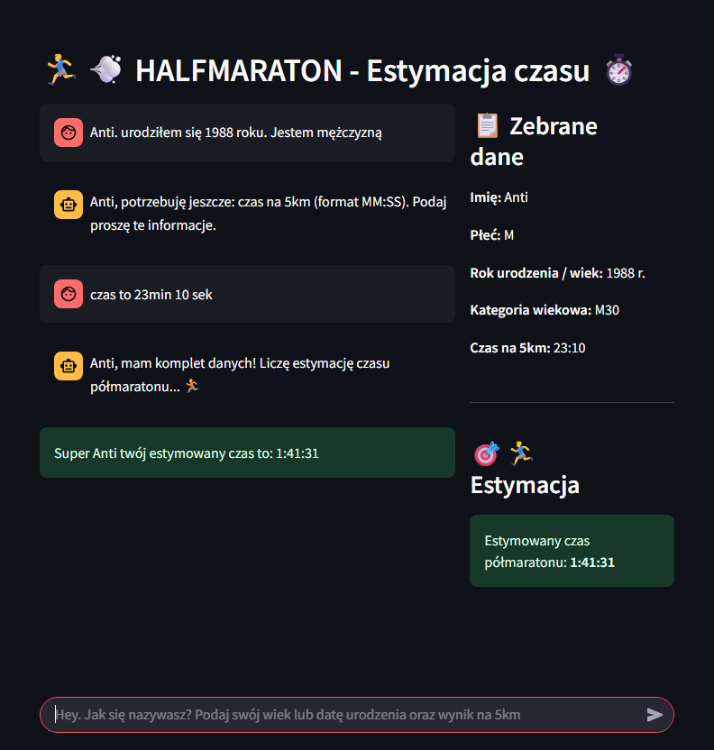
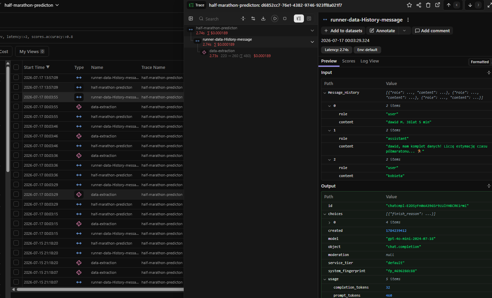

# Half-Marathon Predictor — AI & Machine Learning

Estimate a half-marathon finish time using **natural-language input** and a trained **machine learning regression model**.

[View on GitHub](https://github.com/agentsDawid/half-marathon-aprox-app){ .md-button .md-button--primary }
[Launch Live App](https://half-marathon-aprox-lvwcs.ondigitalocean.app/){ .md-button .streamlit-button }

## Application Preview

## Project Overview

This project combines a conversational interface with a machine learning prediction pipeline. Users describe their running profile and recent **5 km result** in everyday language. An OpenAI-powered extraction layer identifies the required information, while a **PyCaret regression model** estimates their half-marathon finish time.

The app asks for missing information and displays the extracted runner profile alongside the prediction.

## Key Features

- **Natural-language input:** Provide a running result and personal details in a conversational format.
- **Structured data extraction:** OpenAI GPT-4.1 Mini processes messages into fields used by the prediction pipeline.
- **Input validation:** The application requests missing age or birth year, gender, and 5 km time.
- **Machine learning prediction:** A trained PyCaret regression model estimates the half-marathon finishing time.
- **Transparent user interface:** Streamlit displays collected details and the estimated result.
- **LLM observability:** Langfuse integration supports tracing of language-model interactions.

## How It Works

1. The runner enters their profile and a recent **5 km finish time**.
2. The LLM extracts structured information from the message.
3. Python validates the required fields and prepares model features.
4. The regression model generates an estimated half-marathon finish time.
5. Streamlit presents the result and collected runner data.

## Technology Stack

| Technology | Role |
|---|---|
| Python | Application logic and feature preparation |
| Streamlit | Interactive user interface |
| OpenAI API / GPT-4.1 Mini | Natural-language data extraction |
| PyCaret | Regression-based time estimation |
| Pandas | Data processing |
| Pydantic | Structured data validation |
| Langfuse | LLM tracing and observability |
| DigitalOcean | Cloud deployment and model storage integration |

## LLM Observability

Langfuse is used to inspect and monitor LLM interactions during data extraction.

## Project Links

- [Source code on GitHub](https://github.com/agentsDawid/half-marathon-aprox-app)
- [Live application](https://half-marathon-aprox-lvwcs.ondigitalocean.app/)

*Predictions are estimates based on a trained model and input data, not guaranteed race outcomes.*
