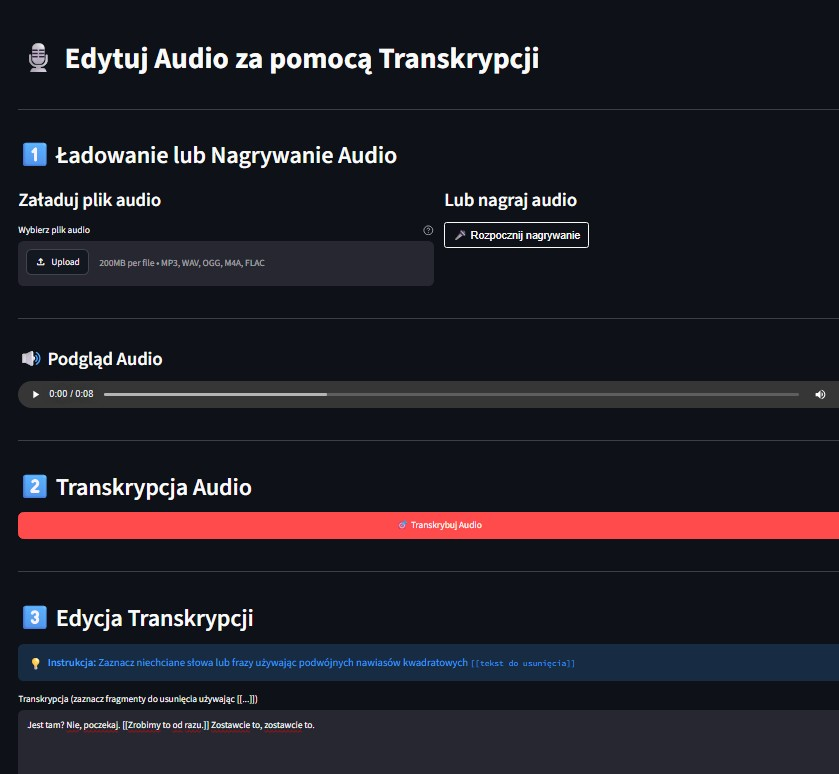

# Audio Editor by Transcription

Edit audio recordings by editing their transcripts. Upload or record audio, transcribe speech with OpenAI Whisper, mark unwanted phrases using `[[double brackets]]`, and generate a trimmed recording.

[View on GitHub](https://github.com/agentsDawid/app_edit_audio_by_transcription.git){ .md-button .md-button--primary }
[Launch Streamlit App](https://app-edit-audio-by-transcription.streamlit.app){ .md-button .streamlit-button }

## Application Preview

## Key Features

- Upload supported audio files or record speech directly in the browser.
- Transcribe speech using OpenAI Whisper.
- Mark multiple unwanted words or phrases with `[[...]]`.
- Remove matching audio segments using transcription timing information.
- Preview and download the edited audio.

## How It Works

1. Upload or record an audio clip.
2. Generate a transcription.
3. Mark words or phrases to remove with `[[...]]`.
4. Process, preview, and download the edited audio.

## Technology Stack

| Technology | Purpose |
|---|---|
| Python / Streamlit | Application and user interface |
| OpenAI Whisper | Speech transcription and timestamps |
| Pydub / FFmpeg | Audio processing and conversion |
| streamlit-audiorecorder | In-browser recording |

