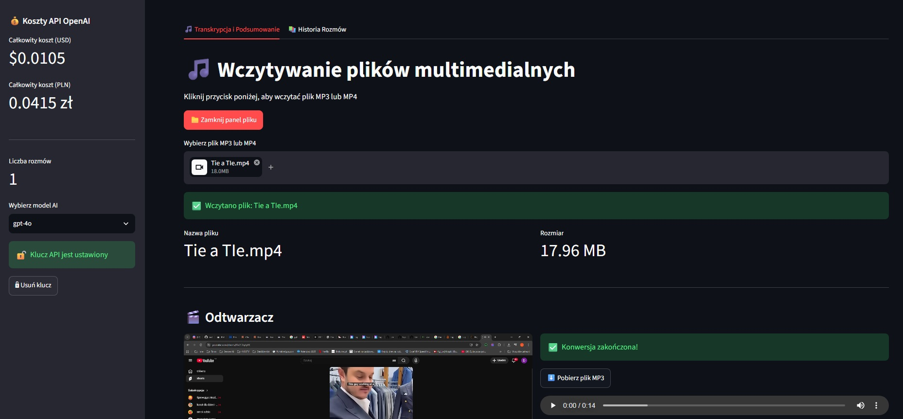

# Video & Audio Summarizer

Convert spoken content from media files into readable transcripts and concise AI-generated summaries. The application also tracks estimated API costs and lets users save, import, and export their processing history.

[View on GitHub](https://github.com/agentsDawid/app_video_audio_summary.git){ .md-button .md-button--primary }
[Launch Streamlit App](https://app-video-audio-summary-AD.streamlit.app){ .md-button .streamlit-button }

## Application Preview

## Key Features

- Upload media and prepare audio for transcription.
- Transcribe speech with OpenAI Whisper (`whisper-1`).
- Generate summaries with a selectable GPT model (`gpt-4o` or `gpt-4o-mini`).
- Preview audio and download text results.
- Review estimated transcription and summarization costs.
- Save, import, export, and delete conversation history.

## How It Works

1. Upload a media file and preview the audio.
2. Transcribe the audio with Whisper.
3. Generate an AI summary of the transcript.
4. Download results or save the session to history.

## Technology Stack

| Technology | Purpose |
|---|---|
| Python / Streamlit | Interactive application |
| OpenAI Whisper | Speech-to-text transcription |
| OpenAI GPT-4o / GPT-4o mini | AI summaries |
| Pydub / FFmpeg | Media-to-audio conversion |
| JSON / Pandas | History and data processing |

